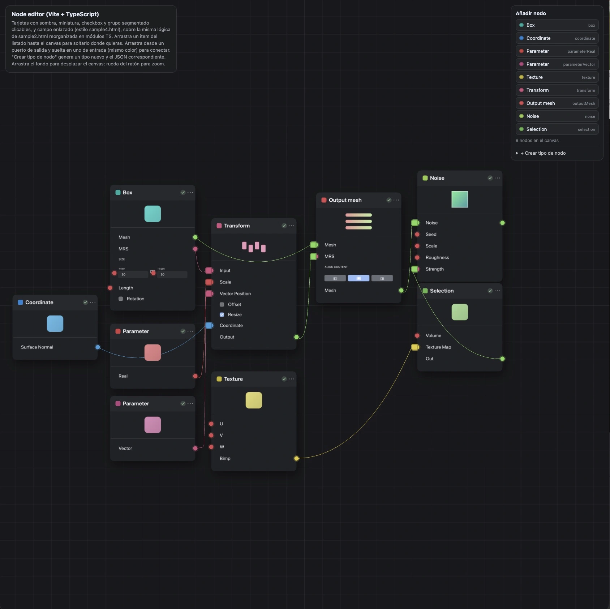

# Node Editor

Editor visual de nodos 2D construido con **Three.js**, **Vite** y **TypeScript**.
Las tarjetas, los cables con física de cuerda y toda la UI viven en una escena
orthographic de Three.js; el motor es framework-agnostic y hay wrappers listos para
**Vue 3, Nuxt 3 y React** como paquetes npm publicables.



## Características

- Tarjetas de nodo con sombra, miniatura, checkbox, secciones y campos enlazables (par Width/Height con icono de cadena)
- Arrastra nodos desde la paleta al canvas
- Conecta puertos de salida a entrada arrastrando: cables con física verlet (gravedad, relajado/tensado) e imán de snap por color de puerto
- Creación de tipos de nodo personalizados desde la UI (con preview del JSON resultante)
- Zona de borrado: arrastra un nodo hasta la esquina inferior derecha para eliminarlo
- Pan del canvas (arrastrar fondo) y zoom (rueda del ratón)
- Elevación y animación física de nodos al interactuar ("gota de agua" al soltar, repulsión entre tarjetas)
- Temas dark/light que reconstruyen las texturas sin perder posiciones ni conexiones
- Export/import del grafo completo (tipos + puertos + nodos + edges) como JSON

## Repo: qué es cada cosa

```
.
├── app/                  # demo original standalone (sin workspaces)
│   └── src/
│       ├── config/       # graph.json (catálogo de tipos + grafo inicial)
│       ├── core/         # Graph, NodeView, Cable, PortRegistry, shapes, viewport
│       ├── systems/      # InputController, PhysicsSystem, ElevationSystem
│       ├── ui/           # Palette, NodeTypeEditor, Toolbar
│       └── main.ts       # bootstrap con IDs fijos del HTML
├── packages/             # monorepo npm (workspaces)
│   ├── core/             # @node-editor/core — NodeEditorEngine autocontenido
│   ├── vue/              # @node-editor/vue — componente + composable
│   ├── nuxt/             # @node-editor/nuxt — módulo Nuxt 3 (client-only)
│   └── react/            # @node-editor/react — componente + hook
├── examples/
│   ├── vite-vue/         # :5401
│   ├── vite-react/       # :5402
│   └── nuxt-app/         # :5403
├── test/                 # verificación Playwright multi-framework
└── nodes.html sample*.html  # prototipos tempranos
```

`app/` y `packages/core/src` comparten el mismo motor; la diferencia es que el core
empaquetado no depende de IDs globales del documento: construye su propia UI dentro
del contenedor que le pases, mide con `ResizeObserver` y libera todo en `destroy()`.

## Demo standalone

```bash
cd app
npm install
npm run dev   # http://localhost:5173
```

## Paquetes npm (monorepo)

| paquete | versión | descripción |
| --- | --- | --- |
| [`@node-editor/core`](packages/core) | 0.1.0 | motor framework-agnostic (`NodeEditorEngine`) con UI autocontenida |
| [`@node-editor/vue`](packages/vue) | 0.1.0 | componente `<NodeEditor>` + composable `useNodeEditor` (Vue 3) |
| [`@node-editor/nuxt`](packages/nuxt) | 0.1.0 | módulo Nuxt 3: auto-importa `<NodeEditor>` solo-cliente |
| [`@node-editor/react`](packages/react) | 0.1.0 | componente `<NodeEditor>` + hook `useNodeEditor` |

Los cuatro exportan ESM + CJS + tipos `.d.ts`; `three` es peerDependency. Los READMEs
de cada paquete traen la API completa; abajo un resumen.

### Instalación y scripts (desde la raíz)

```bash
npm install                                # workspace raíz (packages/* + examples/*)
npm run build -w @node-editor/core         # tsup: ESM+CJS+d.ts
npm run build -w @node-editor/vue          # vite lib + vue-tsc
npm run build -w @node-editor/nuxt         # nuxt-module-build
npm run build -w @node-editor/react        # tsup

# ejemplos (los paquetes ya están enlazados por workspaces):
npm run dev:vue    # http://localhost:5401
npm run dev:react  # http://localhost:5402
npm run dev:nuxt   # http://localhost:5403
```

### @node-editor/core

```ts
import { NodeEditorEngine, defaultGraphConfig } from "@node-editor/core";

const engine = new NodeEditorEngine(container, {
	config: structuredClone(defaultGraphConfig), // opcional
	theme: "dark",                               // "dark" | "light"
	ui: { palette: true, toolbar: true, typeEditor: true, deleteZone: true },
});

engine.exportJson();            // { nodeTypes, portTypes, graph }
engine.importJson(data);        // reconstruye la escena desde un GraphExport
engine.downloadJson();
engine.setTheme("light");       // preserva posiciones y conexiones
engine.relaxCables(); engine.tenseCables(); engine.reorderNodes();
engine.addNodeType(key, def);   // alta en caliente de un tipo nuevo
const off = engine.on("change", (payload) => {}); // | "nodeDeleted"
off();
engine.destroy();               // rAF, listeners, geometrias, texturas, DOM
```

Toda la UI (paleta, toolbar, papelera, editor de tipos) se genera dentro del
contenedor con clases `.ne-*` y CSS inyectado idempotentemente; nada toca el resto
de tu página. Importable en Node (SSR-safe): el acceso a DOM/WebGL ocurre solo en
el constructor.

### @node-editor/vue

```vue
<script setup lang="ts">
import { ref } from "vue";
import { NodeEditor } from "@node-editor/vue";
import { defaultGraphConfig, type GraphExport } from "@node-editor/core";

const options = { config: structuredClone(defaultGraphConfig), theme: "dark" };
const graph = ref<Partial<GraphExport>>();
</script>

<template>
	<NodeEditor v-model="graph" :options="options" style="height: 100vh" />
</template>
```

`v-model` refleja el estado hacia fuera y reimporta si cambia desde fuera
(comparación profunda normalizada, sin bucles). Eventos: `change`,
`nodeDeleted(id)`, `ready(engine)`. También `useNodeEditor()` para gestionar tú
el host.

### @node-editor/nuxt

```ts
// nuxt.config.ts
export default defineNuxtConfig({ modules: ["@node-editor/nuxt"] });
```

Auto-importa `<NodeEditor>` (componente `.client.vue`: nunca corre en SSR) y
`useNodeEditor`. En páginas, pasa `options` en una `shallowRef` asignada en
`onMounted` — la reactividad profunda de Nuxt serializaría mal los `Set` del
config. Ejemplo funcional en `examples/nuxt-app/pages/index.vue`.

### @node-editor/react

```tsx
import { NodeEditor, type GraphExport } from "@node-editor/react";
import { defaultGraphConfig } from "@node-editor/core";

<div style={{ height: "100vh" }}>
	<NodeEditor
		config={defaultGraphConfig}
		theme="dark"
		onChange={(g: GraphExport) => {}}
	/>
</div>;
```

Callbacks inline seguros (viven en refs, no re-montan el engine), compatible con
StrictMode, `ref` con `getEngine()/exportJson()/importJson()`. También hook
`useNodeEditor()`.

## Formato JSON

El grafo se exporta/importa como:

```jsonc
{
	"portTypes": { "mesh": { "color": "#8ee06a" }, … },
	"nodeTypes": {
		"box": {
			"title": "Box", "color": "#1fb6a8", "thumb": "box",
			"rows": [
				{ "label": "Mesh", "side": "out", "type": "mesh" },
				{ "kind": "section", "label": "Size" },
				{ "kind": "pair", "a": { "label": "Width", "value": 30, "side": "in" }, "b": { … } },
				{ "kind": "checkbox", "label": "Rotation", "checked": false }
			]
		}
	},
	"graph": {
		"nodes": [{ "id": "n1", "type": "box", "x": -320, "y": 140, "w": 236 }],
		"edges": [{ "from": ["n1", "Mesh"], "to": ["n2", "Input"] }]
	}
}
```

`rows` admite `port` (clásico), `section`, `pair`, `checkbox` y `segmented`. El
editor de tipos de la paleta genera exactamente esta forma.

## Verificación (Playwright)

```bash
# smoke del core (servidor vite sobre packages/core/test/):
npx vite packages/core/test --port 5301 &
node packages/core/test/verify-core.mjs

# ejemplos (levantar dev servers primero):
node test/verify-frameworks.mjs                    # vue + react
NUXT_URL=http://localhost:5403/ node test/verify-frameworks.mjs  # + nuxt
```

Compran: montaje del canvas, shell UI completa, export ≥9 nodos, toggle de tema
que preserva el grafo, round-trip de import/export, drag desde la paleta que suma
un nodo reflejado en el estado reactivo del framework, eventos y limpieza en
`destroy()`.

> Nota: en esta máquina el Chromium empaquetado con Playwright falla al crear el
> contexto WebGL (driver AMD). Los scripts usan `chromium.launch({ channel: "chrome" })`
> con Chrome del sistema.

## Stack

- [Three.js](https://threejs.org/) — renderizado 2D orthographic, InstancedMesh, SVGLoader
- [Vite](https://vitejs.dev/) / [tsup](https://tsup.egoist.dev/) / [unbuild](https://github.com/unjs/unbuild) — bundlers
- [Vue 3](https://vuejs.org/), [Nuxt 3](https://nuxt.com/), [React 18](https://react.dev/) — wrappers
- [Playwright](https://playwright.dev/) — verificación end-to-end

## Roadmap pendiente

- Publicar el scope `@node-editor` en npm (decidir owner del scope antes de `npm publish`)
- `sideEffects: false` + tree-shaking fino del CSS inyectado
- Persistir el tema elegido entre sesiones del editor
